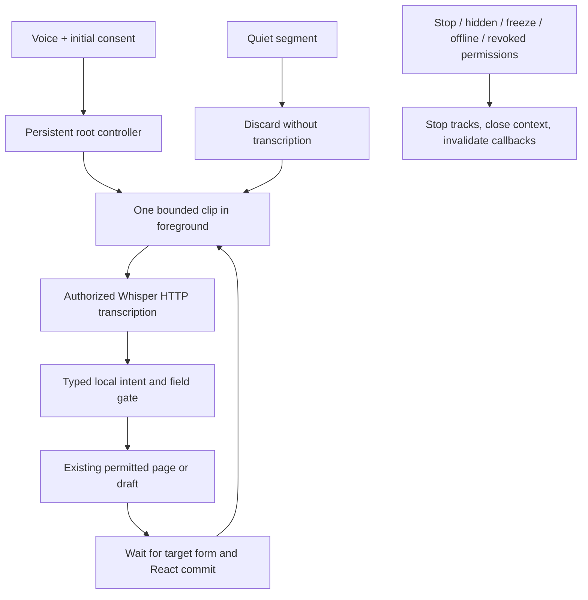

# Voice Premium — foreground sessions (experimental branch)

Base: verified `1bc18de`, new branch `codex/voice-premium-session`.
Production, the base branch, database, accounts, RLS, secrets and Security PSG are
unchanged. No merge, deployment, paid provider or model download is performed.

## Why the old interaction was fragmented

VoiceAgent belonged to each page's SnoopLayout; navigating unmounted it and lost
session state. Its hook included the pathname in capture scope and released the
microphone/AudioContext after every phrase. Every next utterance required another
activation and repeated availability/device startup. The normal UI was also the
advanced panel. The earlier lifecycle fix solved stale stop callbacks but did not
make the architecture conversational.

There is no physical recording available here that establishes the cause of wrong
Samsung words or a real WER. Claiming an ASR accuracy improvement would be unsupported.

## Architecture actually implemented

The host lives above the keyed route Outlet. Security identity/club/role/permissions
still stop the session; route changes no longer destroy it. Voice navigation waits
for an actual visible destination form. Manual navigation discards the old segment.
One microphone and AudioContext are retained between phrases. No recorder runs
while the previous clip is being transcribed/interpreted; no overlapping recordings.
The app indicates those waiting phases instead of pretending to hear new words.

Normal use shows a compact blue/gold badge with immediate Stop and an advanced
settings button. Space is reserved above the header; focused fields respect it.
The large panel appears only in explicit advanced settings. Initial consent starts
the session; later utterances rearm automatically. Stop phrases include Terminar,
Detener escucha, Stop Snoop and Italian equivalents. Background/pagehide/freeze,
offline, permission loss, identity changes and provider errors stop/release it;
returning to the app does not silently resume recording.

Intent handling uses a typed local command/uncertainty/stop registry, navigation
aliases, existing field decoders and exact current-club categories. It does not use
an external text model or guess personal names. Unknown/ambiguous commands ask for
a brief clarification. Guardar/cobrar/eliminar/anular do not execute by voice.
Consecutive member and product field dictation patches only supplied values.
A manual edit made during transcription wins. Financial saves remain manual.

Silence is not uploaded just to maintain the session. Clips are memory-only,
bounded at 60 seconds/8 MB; quiet clips are discarded, including the timer race.
Availability is cached for 30 seconds within verified scope; each transcription
still uses the existing authenticated server middleware. HTTP waiting is bounded;
errors pause rather than loop/retry and consume quota. Already transmitted audio
cannot be recalled; cancellation ignores its response and prevents further capture.

The existing Whisper binding remains. Its documented initial_prompt is a static
IT/ES administrative glossary, without club/member data. The documented
condition_on_previous_text=false prevents conditioning loops; vad_filter remains on.
These settings are covered by payload tests, not a live accuracy certification.

## Available alternatives checked

| Option | Evidence / decision |
| --- | --- |
| Cloudflare Whisper Large V3 Turbo | Current authorized binding. Official schema accepts a clip and returns text; this integration is NOT streaming. Public list price $0.000513/audio minute; existing free quota only, not unlimited usage. No paid tier enabled. |
| Cloudflare Nova-3 | Official docs describe WebSocket real-time ASR, $0.0092/audio minute / 836.36 neurons per minute. Account availability, partner conditions and usable free budget are not verified. Not activated. |
| Browser on-device SpeechRecognition | processLocally API is exposed in the tested Chromium; no language pack was installed or verified ready. WebKit runtime does not expose it. Cannot make it a portable mandatory dependency or silently fall back to Google/Siri remote recognition. |
| Local Whisper/WASM/WebGPU | Possible independent approach, but model download, RAM/battery and phone speed require device benchmarks. Not installed or declared ready; no heavy model added to SNOOP. |

References: [Whisper schema](https://developers.cloudflare.com/workers-ai/models/whisper-large-v3-turbo/),
[Nova-3](https://developers.cloudflare.com/workers-ai/models/nova-3/),
[on-device browser API](https://developer.mozilla.org/en-US/docs/Web/API/SpeechRecognition/processLocally).
A session on the current free batch provider has a phrase-end wait (default 1.6s)
plus HTTP/model latency. It cannot honestly promise instant full-duplex streaming.
The UI marks transcription/execution; speech during that interval is not recorded.

## Measured performance — simulations, NOT live Whisper

Real rendered app, synthetic recorder/analyser and simulated transcription API.
There are nine timed clips per browser, including deliberately ignored/ambiguous
commands. One response is held 1.2s and one catalogue read delayed 2.4s. Values below
are medians in milliseconds. They do not measure the physical microphone, actual
Cloudflare model, WAN upload speed or ASR word accuracy.

| Browser viewport | Clips | Startup | Capture incl. endpoint | Encode | Transcription HTTP fixture | Local intent | UI execution/readiness | Total |
| --- | --- | --- | --- | --- | --- | --- | --- | --- |
| samsung | 9 | 0.1 | 2040.7 | 0.9 | 4.3 | 0.2 | 19.6 | 2067.6 |
| iphone-webkit | 9 | 0.0 | 1980.0 | 3.0 | 3.0 | 0.0 | 69.0 | 2163.0 |

Capture is recorder-start to stop. HTTP timing includes transport/server/model as
one span; client instrumentation cannot separate those components. Local intent
is the typed gate; execution includes the existing field parser, dispatch/navigation,
form readiness and two render frames. Cold catalogue loading is consequently visible
in execution time. Metrics contain numbers only, no audio or member data; the app
keeps only 20 in memory and shows the latest in advanced settings.

The browser test asserts **one getUserMedia acquisition** through the member and
product sequence and navigation. Warm startup reuses it; this is a tested reduction
in repeated setup, not a claim about live ASR speed. Raw timings and capability probes
are in [VOICE_SESSION_RESULTS.json](VOICE_SESSION_RESULTS.json).

## Tests and limits

Targeted local results: 278 unit/security tests PASS, TypeScript, Node/Workers build,
public bundle secret scan, recorder lifecycle, native Chromium tone/silence recording,
continuous Chromium/WebKit session, existing single-dictation suite and critical
keyboard/PWA tests. The PR runs the full existing administrative regression as well.

The continuous sequence checks creation of the member form, Carlos/García, birth date,
city/phone in successive phrases, IT correction, ambiguous intent, delayed response
with manual edit protection, product creation and field patches, spoken stop/restart,
freeze, provider error, denied microphone and club-permission revocation. Zero automatic
writes. Data and remote responses are synthetic. No physical Samsung/iPhone or live
Whisper test is claimed. Low synthetic noise and pauses are tested; real club noise,
accents, microphone processing, iOS permission/background behaviour and WER remain
physical pilot checks. New model availability/free quota is not certified.

## Minimal Samsung pilot after an explicitly authorized HTTPS preview

1. Open the preview connected to a synthetic test environment; choose Español once
   in advanced settings if necessary. Tap Voice and permit Cloudflare transcription.
2. Say Crear socio, then Nombre Carlos apellido García, then Fecha de nacimiento
   15 de marzo de 1995, then Ciudad Palma teléfono 666123456. Do not press Save.
3. Say Terminar; verify the OS microphone indicator goes off. Repeat with background
   and reopen, and note any wrong word plus the numerical times in advanced settings.

No preview deployment has been performed by this change. Live transcription/WER
and real network timings are BLOCKED until that authorized test is available.
